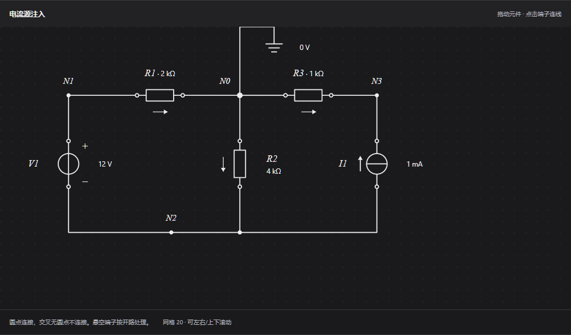
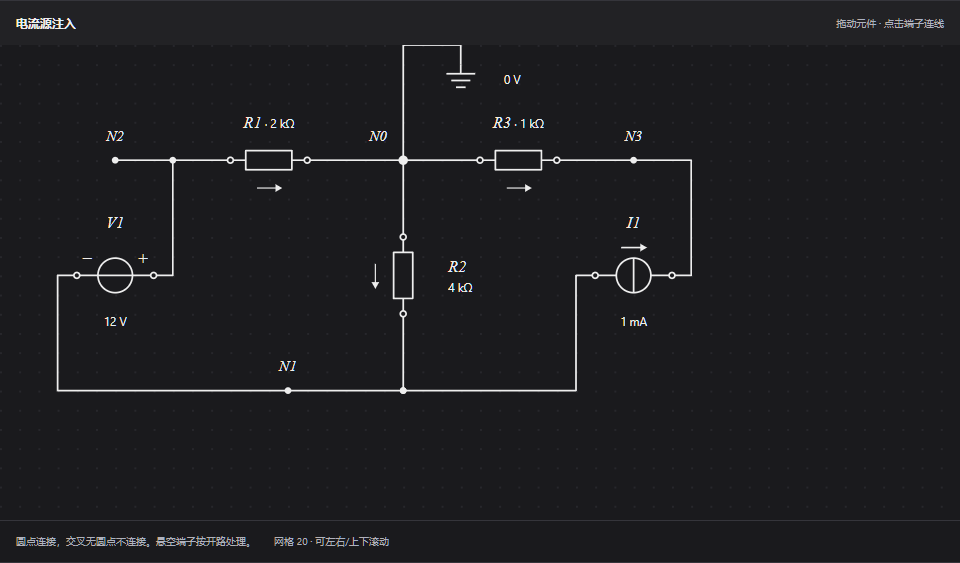

# 电路方程生成器：旋转、接地与符号修复

日期：2026-10-17。

## 原因与修复

- 原旋转逻辑在旧导线前后不断追加折线。连续操作后，旧端子与新端子之间的线路可能重合，把不同节点意外连接。现在改为网格路径搜索，重新规划相关导线，保留既有分支接点，并在应用前比较全部元件端子的连接关系和参考地归属；无法保持连接时不应用该次操作。
- 移动时使用相同的路径规划与连接校验。移动和旋转均不会持续累积旧引线；选中的符号、端子与结果保持对应。
- 参考地只能设置在真实端子或导线上，不能放进元件内部或空白处。再次使用接地工具会移动原参考地，不会把不同节点同时接成0 V。未连接的交叉线需先明确连接后才能设置参考地。
- 接地的电气接入点仍在选定节点上；若竖直线路占用符号位置，图形通过短引线偏移到空白处。引线、三条接地横线、0 V文字和节点标签统一避让。
- 竖放电压源、电流源采用左侧名称、右侧数值。电压源正负号放在右侧上下位置，并随端子极性正确变化；横放时名称、数值分列上下。所有文字保持正向，电流箭头随元件方向变化。
- 修复选框压住正负号、节点标签，以及画板重建后Esc失效的问题。撤销、重做会重建临时拖动状态，避免旧预览覆盖新图纸。
- 导线穿过元件本体会显示明确诊断，不再把这种异常图形当作有效短路并显示计算结果。旧图纸如果已经含有错误接线，可删除相应导线重画，或从“载入示例”恢复标准连接；不会猜测原意并自动删除用户线路。

## 文件与影响

| 文件 | 修改内容 |
| --- | --- |
| `src/lib/circuit-equations/routing.ts` | 新增路径搜索、元件移动与旋转、连接保持检查、参考地设置校验 |
| `src/lib/circuit-equations/geometry.ts` | 删除旧的追加引线逻辑，合并冗余直线点并保留真实分支 |
| `src/lib/circuit-equations/annotations.ts` | 统一源的文字/极性坐标、接地引线、文字与选框避让范围 |
| `src/lib/circuit-equations/labels.ts` | 节点标签使用统一的元件与接地占位数据 |
| `src/lib/circuit-equations/topology.ts` | 提供导线所属节点，识别导线穿过元件，网孔标记复用新的避让范围 |
| `src/components/circuit-equations/CircuitEditor.tsx` | 捕获不可应用的操作，接地改为移动参考地，操作后清理旧预览 |
| `src/components/circuit-equations/CircuitCanvas.tsx` | 修复键盘焦点、拖动失败恢复和接地符号点选坐标 |
| `src/components/circuit-equations/CircuitDrawing.tsx` | 应用新符号标注、选框尺寸和接地绘制 |
| `src/components/circuit-equations/ComponentLibrary.tsx` | 更新接地和旋转操作说明 |
| `tests/circuit-equations.test.ts` | 增加反复旋转、移动往返、接地、异常图纸和符号方向验证 |
| `tests/browser/circuit-equations.spec.ts` | 增加真实旋转、四方向源符号、选框、接地移动/删除及遮挡检查 |
| `tests/capture-equation-fixes.mjs` | 保存接地避让和连续旋转后的图形证据 |

修改范围为生成器及其测试，没有改动教材内容、原有公式速查和学习数据。图纸格式仍为version 1，原有导入导出兼容；既有绘图数据不被自动清除。

## 验收

- 68项单元/内容测试通过，其中23项覆盖生成器。三个示例的每个元件连续旋转12次，逐次检查节点数、支路电压电流、功率平衡及导线路径长度。
- 13项生成器浏览器测试通过，包含空白绘图、拖动、键盘、旋转、反转、撤销/重做、JSON保存导入、异常电路、移动端、四个方向的源符号及1440px浅色/390px深色标签检查。
- TypeScript、ESLint和生产构建通过。日志和部署截图保存在`D:\codex\电路\work\equation-generator\fixes`。
- 人工检查下方接地移动及旋转后截图，核对源极性、箭头、导线与文字。

复验：启动生产服务后运行`npm test`及`npx playwright test tests/browser/circuit-equations.spec.ts`；截图运行`node tests/capture-equation-fixes.mjs`。
